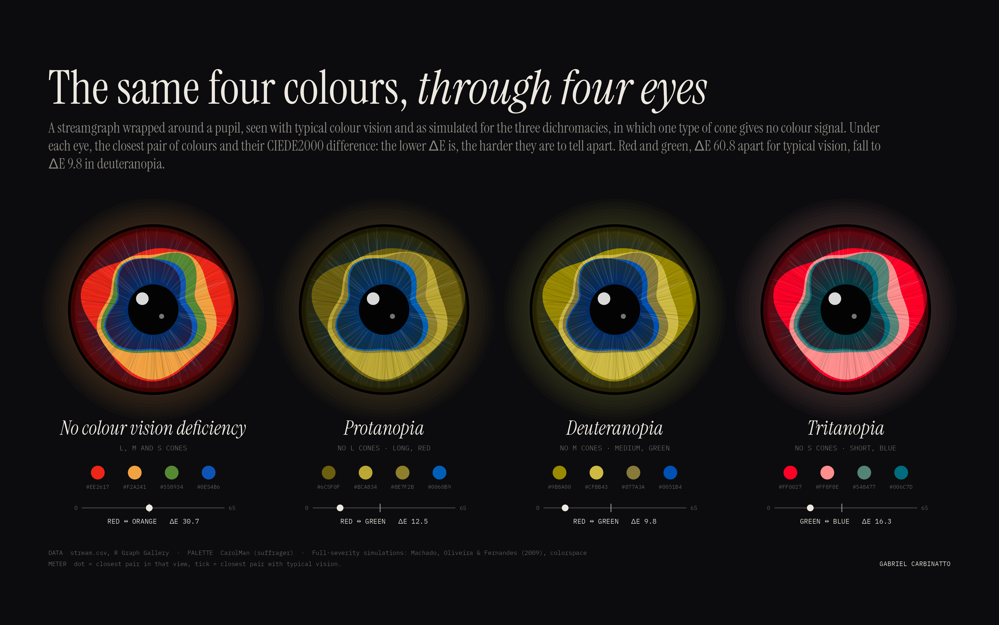

# The same four colours, through four eyes

## Summary

Wraps a streamgraph into a ring around a pupil, so that it reads as an iris, and draws it four times: with no colour vision deficiency and as simulated for the three dichromacies, in which one type of cone gives no colour signal. Under each eye, the four colours as they are seen and a meter with the closest pair, measured with the CIEDE2000 colour difference (ΔE). The result is a single landscape chart (16:10), `viz/color-vision-deficiency-comparison.png`:

- **No colour vision deficiency.** The closest pair is red and orange, ΔE 30.7.
- **Protanopia** (no L cones). Red, orange and green turn into olive tones; red and green fall to ΔE 12.5.
- **Deuteranopia** (no M cones). The same collapse, stronger: red and green at ΔE 9.8, against 60.8 in the original palette.
- **Tritanopia** (no S cones). Green and blue become two teals, ΔE 16.3.



## Method

- **Data.** The `stream.csv` example dataset from the [R Graph Gallery](https://r-graph-gallery.com/): four groups over ten periods.
- **Palette.** CarolMan, from the suffrager package (available through paletteer): `#EE2617`, `#F2A241`, `#558934`, `#0E54B6`.
- **Simulation.** `protan()`, `deutan()` and `tritan()` from colorspace at full severity, which implement the Machado, Oliveira and Fernandes (2009) model. Simulations approximate typical colour confusions, not the perception of each person.
- **Iris.** Each group is smoothed with a periodic spline so that the last period joins the first, the layers are stacked symmetrically as in a streamgraph and the result is mapped to polar coordinates between the pupil and the limbus. Fibres, the dark base and the catchlight are decoration and carry no data.
- **Colour difference.** CIEDE2000 between every pair of the four simulated colours, computed with farver. Each meter marks the smallest one (dot) against the smallest with typical vision (tick).

## Structure

- `R/color-vision-deficiency-comparison.R`: simulations, colour differences and the irises, with ggplot2 and ggtext.
- `data/processed/stream.csv`: the example dataset.
- `assets/fonts/`: Instrument Serif and IBM Plex Mono, with their OFL licences.
- `viz/`: final chart.

## Running

The script runs from the project root:

```bash
Rscript -e 'install.packages(c("colorspace", "dplyr", "farver", "ggplot2", "ggtext", "purrr", "ragg", "readr", "stringr", "systemfonts", "tidyr"))'
Rscript R/color-vision-deficiency-comparison.R
```

## References

- Machado, G. M., Oliveira, M. M. and Fernandes, L. A. F. (2009). [A physiologically-based model for simulation of color vision deficiency](https://doi.org/10.1109/TVCG.2009.113).
- Sharma, G., Wu, W. and Dalal, E. N. (2005). [The CIEDE2000 color-difference formula](https://doi.org/10.1002/col.20070).
